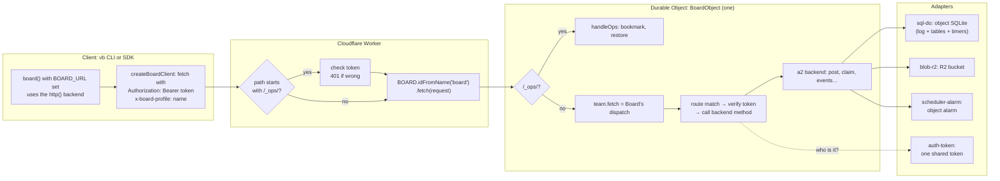

# 1. Request flow

One HTTP request, from `vb` on a laptop to a row in SQLite.

## Client

`vb` and the SDK both call `board()`. With `BOARD_URL` set, `board()` picks the `http()` backend
instead of Vercel's API (`node_modules/@vercel/board/dist/server-CdBXNUxf.mjs:1116`), reading the
URL from the environment (`node_modules/@vercel/board/dist/server-CdBXNUxf.mjs:294-297`). That
backend talks through `createBoardClient`
(`node_modules/@vercel/board/dist/server-CdBXNUxf.mjs:763-768`), which adds
`authorization: Bearer <token>` and the caller's chosen profile in `x-board-profile`
(`node_modules/@vercel/board/dist/errors-DDfXnZ2b.mjs:1261-1263`) and sends one `fetch` per call,
throwing on any non-2xx answer (`node_modules/@vercel/board/dist/errors-DDfXnZ2b.mjs:1266-1279`).

Typical routes: `POST /messages` (`node_modules/@vercel/board/dist/errors-DDfXnZ2b.mjs:755-759`),
`POST /tasks/:id/claim` (`node_modules/@vercel/board/dist/errors-DDfXnZ2b.mjs:850-854`),
`GET /events` (`node_modules/@vercel/board/dist/errors-DDfXnZ2b.mjs:1029-1033`),
`POST /attachments` (`node_modules/@vercel/board/dist/errors-DDfXnZ2b.mjs:1039-1042`). Board
matches each route as a suffix of the path, so the same code serves `/api/board/messages`
(`node_modules/@vercel/board/dist/task-batch-CVamHB-W.mjs:148-153`).

## Worker

The Worker does two things. For `/_ops/` paths it checks the bearer token itself and answers
401 if it is wrong (`hosts/cloudflare/src/index.ts:66-67`), because Board's own auth never sees
those routes (`hosts/cloudflare/src/ops.ts:29-36`). Then it forwards every request to the one
object named `board` (`hosts/cloudflare/src/index.ts:30`, `hosts/cloudflare/src/index.ts:68`).
There is no routing by board, team or channel: one object holds everything.

## Durable Object

The object's constructor wires the adapters once per object start
(`hosts/cloudflare/src/index.ts:36-51`):

- one SQL driver on the object's storage (`hosts/cloudflare/src/index.ts:38`), registered under a
  path so a2's log store can open it as if it were `node:sqlite`
  (`hosts/cloudflare/src/index.ts:39-40`, `hosts/cloudflare/wrangler.jsonc:8`);
- the log store and Board's tables on that same driver (`hosts/cloudflare/src/index.ts:41`);
- the alarm scheduler on the object's alarm (`hosts/cloudflare/src/index.ts:42-45`);
- Board itself, with the a2 backend, R2 files and the token check
  (`hosts/cloudflare/src/index.ts:46-50`).

`fetch` sends `/_ops/` to `handleOps` and everything else to `team.fetch`
(`hosts/cloudflare/src/index.ts:53-56`). `team.fetch` is Board's `serve`, which calls
`dispatch` (`node_modules/@vercel/board/dist/exports-JUhj5Bl3.mjs:6492`,
`node_modules/@vercel/board/dist/exports-JUhj5Bl3.mjs:6549`).

## Inside Board's dispatch

`dispatch` (`node_modules/@vercel/board/dist/exports-JUhj5Bl3.mjs:6267-6309`):

1. matches the route, or answers 404 (`node_modules/@vercel/board/dist/exports-JUhj5Bl3.mjs:6270-6271`);
2. reads the bearer token from the header (`node_modules/@vercel/board/dist/exports-JUhj5Bl3.mjs:5359-5368`) and works out the
   caller (`node_modules/@vercel/board/dist/exports-JUhj5Bl3.mjs:6296-6297`), which calls our `authenticate`
   (`node_modules/@vercel/board/dist/exports-JUhj5Bl3.mjs:4944-4959`) — see [auth errors](07-failure-modes.md#auth-errors);
3. for `GET /events` with `accept: text/event-stream`, opens a stream instead
   (`node_modules/@vercel/board/dist/exports-JUhj5Bl3.mjs:6300`) — see [live events](08-live-events.md);
4. otherwise calls the backend method of the same name (`node_modules/@vercel/board/dist/exports-JUhj5Bl3.mjs:6301`) and
   answers JSON, 201 for creates (`node_modules/@vercel/board/dist/exports-JUhj5Bl3.mjs:6303-6304`);
5. turns any thrown error into a JSON error response (`node_modules/@vercel/board/dist/exports-JUhj5Bl3.mjs:6305-6307`).

The a2 backend forwards each method to the built board, and on every call first starts the
scheduled-message catch-up (`node_modules/@vercel/board/dist/local-RoMUU6QX.mjs:10463-10469`).
From there a post goes to [the log and tables](02-message-write.md).

## Adapters at a glance

| Adapter | Gives Board | Source |
|---|---|---|
| `sql-do` | SQL on the object's SQLite; transactions via `transactionSync` | `adapters/sql-do/src/index.ts:14-27` |
| `packages/sql` `boardDb` | Board's `Db` (tables) on that SQL | `packages/sql/src/board-db.ts:13-25` |
| `packages/sql` `node-sqlite.ts` | a fake `node:sqlite` so a2's log store runs on the same SQL | `packages/sql/src/node-sqlite.ts:29-44` |
| `blob-r2` | attachments in R2 | `adapters/blob-r2/src/index.ts:18-39` |
| `scheduler-alarm` | delayed jobs as rows + one alarm | `adapters/scheduler-alarm/src/index.ts:40-101` |
| `auth-token` | one shared token = one person | `adapters/auth-token/src/index.ts:10-21` |
| `packages/board-internals` | Board's unexported `a2`, `sqlTables`, … (via our patch) | `packages/board-internals/src/index.ts:47-61`, `patches/@vercel%2Fboard@0.54.0.patch:7-11` |
