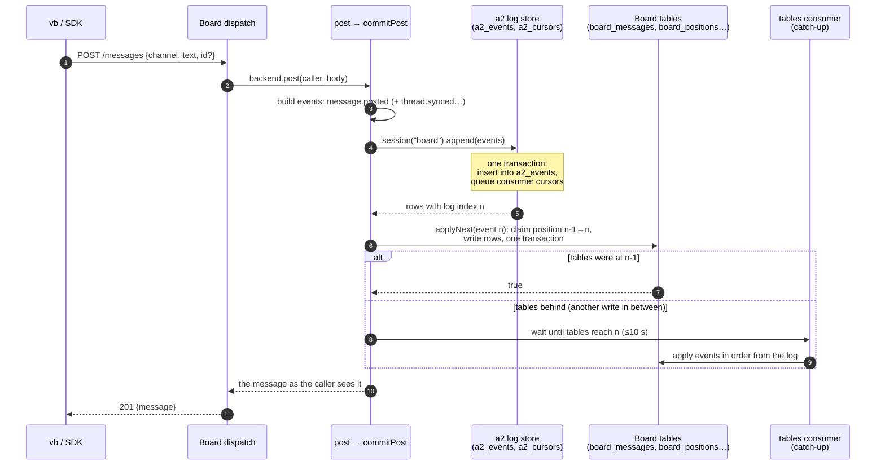

# 2. How a message is written and saved

A post is first an **event** appended to the log, then **rows** in Board's tables. Both live in
the same SQLite database inside the object, but in two separate transactions.

## Steps

1. `POST /messages` reaches the backend's `post`, which calls `postNow`
   (`node_modules/@vercel/board/dist/local-RoMUU6QX.mjs:9448-9449`).
2. `commitPost` builds the events. The main one is `message.posted` with the channel, text,
   reply target, labels, author, attachments and an optional caller-supplied `id`
   (`node_modules/@vercel/board/dist/local-RoMUU6QX.mjs:5366-5391`).
3. It appends them to the log session named `board`
   (`node_modules/@vercel/board/dist/local-RoMUU6QX.mjs:5416`;
   session name: `node_modules/@vercel/board/dist/local-RoMUU6QX.mjs:4096`,
   `node_modules/@vercel/board/dist/local-RoMUU6QX.mjs:9140`). A reply with `--after` or a
   synced thread uses a conditional append instead, which only lands if nothing else landed
   since it looked (`node_modules/@vercel/board/dist/local-RoMUU6QX.mjs:5615-5639`).
4. The a2 store's `append` runs in one transaction
   (`node_modules/@vercel/board/dist/store-sqlite-D6fIszST.mjs:464-507`). In this repo that
   transaction is the object's `transactionSync`, thanks to our patch
   (`node_modules/@vercel/board/dist/store-sqlite-D6fIszST.mjs:344-346`,
   `packages/sql/src/node-sqlite.ts:42`, `adapters/sql-do/src/index.ts:31`). It inserts one row
   per event into `a2_events` (`node_modules/@vercel/board/dist/store-sqlite-D6fIszST.mjs:241-243`).
5. `untilApplied` then tries to write the tables itself: for each new event it calls
   `applyNext` (`node_modules/@vercel/board/dist/local-RoMUU6QX.mjs:5595-5607`).
6. `applyNext` is `commit(event, true)`
   (`node_modules/@vercel/board/dist/sql-D0MqINA6.mjs:908`, `node_modules/@vercel/board/dist/sql-D0MqINA6.mjs:852-857`): it
   computes the row changes and hands Board's `Db` a **claim** (move `board_positions` from
   `n-1` to `n`) plus the writes
   (`node_modules/@vercel/board/dist/sql-D0MqINA6.mjs:653-660`).
7. Our `boardDb.commit` runs claim and writes in one transaction; if the claim matches no row it
   writes nothing and answers `false` (`packages/sql/src/board-db.ts:18-23`).
8. If the tables were not at `n-1`, the writer waits for the tables consumer to catch up, for at
   most 10 seconds, then answers anyway with a warning
   (`node_modules/@vercel/board/dist/local-RoMUU6QX.mjs:5609-5614`). The post is already safe in
   the log either way (`node_modules/@vercel/board/dist/local-RoMUU6QX.mjs:5589-5594`).

## The SQL tables

**Log (a2)**, created by `node_modules/@vercel/board/dist/store-sqlite-D6fIszST.mjs:23-130`:

| Table | Holds | Lines |
|---|---|---|
| `a2_events` | every event: session, index, type, JSON payload, event id | `node_modules/@vercel/board/dist/store-sqlite-D6fIszST.mjs:29-38` |
| `a2_cursors` | each consumer's place and claim on its next event | `node_modules/@vercel/board/dist/store-sqlite-D6fIszST.mjs:45-68` |
| `a2_lane_events` | per-lane work queue for consumers that run per thread/task | `node_modules/@vercel/board/dist/store-sqlite-D6fIszST.mjs:73-82` |
| `a2_snapshots`, `a2_snapshot_history`, `a2_snapshot_pins` | cached reducer state | `node_modules/@vercel/board/dist/store-sqlite-D6fIszST.mjs:84-113` |
| `a2_clears`, `a2_presence`, `a2_meta` | session clears, presence, layout version | `node_modules/@vercel/board/dist/store-sqlite-D6fIszST.mjs:24-27`, `node_modules/@vercel/board/dist/store-sqlite-D6fIszST.mjs:115-129` |

The unique index on `(session_id, event_id)` is what makes a retried post with the same `id`
land once (`node_modules/@vercel/board/dist/store-sqlite-D6fIszST.mjs:40-41`); a batch whose ids
are all already there is answered from the stored rows
(`node_modules/@vercel/board/dist/store-sqlite-D6fIszST.mjs:480-486`).

**Board's tables**, created by `ddl()` (`node_modules/@vercel/board/dist/sql-D0MqINA6.mjs:468-525`)
when the object starts (`packages/sql/src/board-db.ts:14`):

| Table | Holds | Lines |
|---|---|---|
| `board_messages` | one row per message: channel, thread (`re`), author, text, JSON `data` | `node_modules/@vercel/board/dist/sql-D0MqINA6.mjs:474-490` |
| `board_positions` | the last log index the tables applied | `node_modules/@vercel/board/dist/sql-D0MqINA6.mjs:470-473` |
| `board_versions` | earlier versions of edited messages | `node_modules/@vercel/board/dist/sql-D0MqINA6.mjs:497-501` |
| `board_terms` | labels, mentions, attachments as searchable terms | `node_modules/@vercel/board/dist/sql-D0MqINA6.mjs:503-508` |
| `board_sync_threads`, `board_external_*`, `board_copies` | Slack/GitHub sync bookkeeping | `node_modules/@vercel/board/dist/sql-D0MqINA6.mjs:510-521` |

## Three things called "cursor"

- **Consumer cursor**: a row in `a2_cursors`, the place one consumer has reached in one session
  (`node_modules/@vercel/board/dist/store-sqlite-D6fIszST.mjs:45-68`).
- **Tables position**: `board_positions.log_index`, how far the tables are built
  (`node_modules/@vercel/board/dist/sql-D0MqINA6.mjs:640-651`). A read by message ID waits until
  this reaches that ID (`node_modules/@vercel/board/dist/local-RoMUU6QX.mjs:6831-6847`).
- **Feed cursor**: the log index a client gets back from `GET /events`, to ask for "everything
  after this" next time (`node_modules/@vercel/board/dist/local-RoMUU6QX.mjs:5055-5059`,
  `node_modules/@vercel/board/dist/local-RoMUU6QX.mjs:9810-9814`).

## Why log first, tables second

The tables can always be rebuilt from the log. The tables consumer reads the `board` session
from the first event and applies each one (`node_modules/@vercel/board/dist/local-RoMUU6QX.mjs:6761-6772`);
`apply` skips events the tables already have
(`node_modules/@vercel/board/dist/sql-D0MqINA6.mjs:904-907`). So if a table write fails, the
message is not lost: the next catch-up writes it.

Both the log and the tables share one SQLite connection
(`packages/sql/src/driver.ts:4-8`, `hosts/cloudflare/src/host.ts:28-29`).
