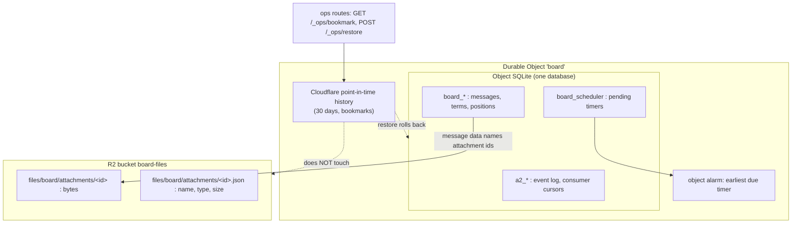
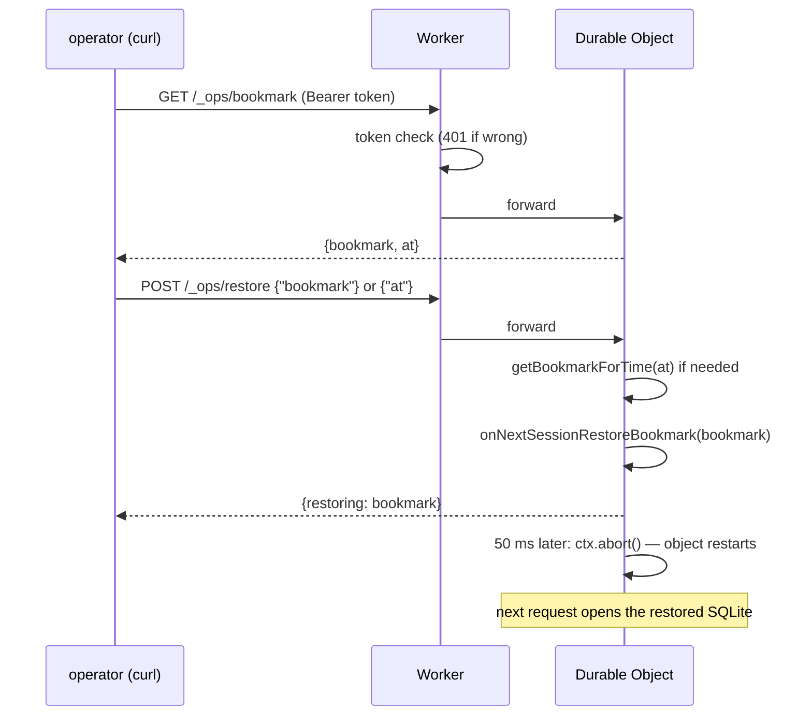

# 3. Persistence

Everything except file bytes is in the object's own SQLite. File bytes are in R2. Cloudflare
keeps 30 days of SQLite history, which our `/_ops/` routes can roll back to.

## SQLite in the object

The object class is a SQLite-backed Durable Object (`hosts/cloudflare/wrangler.jsonc:9`,
`hosts/cloudflare/wrangler.jsonc:11`). Three sets of tables share its one database:

| Tables | Created by | Source |
|---|---|---|
| `a2_*` (log) | a2's store, on open | `node_modules/@vercel/board/dist/store-sqlite-D6fIszST.mjs:239` (schema `:23-130`) |
| `board_*` (tables) | `boardDb()`, on object start | `packages/sql/src/board-db.ts:14`, `node_modules/@vercel/board/dist/sql-D0MqINA6.mjs:468-525` |
| `board_scheduler` | `alarmScheduler()`, on object start | `adapters/scheduler-alarm/src/index.ts:17-23`, `adapters/scheduler-alarm/src/index.ts:41` |

All are `create table if not exists`, so a restarted object reopens the same data.

a2's store was written for `node:sqlite` on a file. The host aliases `node:sqlite` to our
stand-in (`hosts/cloudflare/wrangler.jsonc:7-8`), which opens the driver registered for that
path (`packages/sql/src/node-sqlite.ts:9-15`, `packages/sql/src/node-sqlite.ts:29-35`). The
stand-in quietly skips the `pragma journal_mode | synchronous | busy_timeout` settings a2 sends,
since the object's SQLite owns them (`packages/sql/src/node-sqlite.ts:17-18`,
`packages/sql/src/node-sqlite.ts:37`; a2 sends them at
`node_modules/@vercel/board/dist/store-sqlite-D6fIszST.mjs:232-234`), and refuses raw
`BEGIN`/`COMMIT` (`packages/sql/src/node-sqlite.ts:19`, `packages/sql/src/node-sqlite.ts:38`).
Transactions go through `transactionSync` instead: see
[failure modes](07-failure-modes.md#a-write-that-fails-halfway).

## Attachments in R2

- Binding `FILES` → bucket `board-files` (`hosts/cloudflare/wrangler.jsonc:10`), passed to
  `r2Blob` (`hosts/cloudflare/src/index.ts:48`).
- Every key is put under `files/` (`adapters/blob-r2/src/index.ts:18`,
  `adapters/blob-r2/src/index.ts:28`), so the bucket can hold other things later, like backups
  (`adapters/blob-r2/src/index.ts:14-15`).
- Board names its keys `board/attachments/<id>` for bytes and `board/attachments/<id>.json` for
  metadata (`node_modules/@vercel/board/dist/local-RoMUU6QX.mjs:6626`,
  `node_modules/@vercel/board/dist/local-RoMUU6QX.mjs:6629`).
- An upload is two R2 writes, bytes then metadata, under a fresh random id
  (`node_modules/@vercel/board/dist/local-RoMUU6QX.mjs:6646-6662`). A message refers to the file
  by id only; the bytes never enter SQLite.
- The limit is 4 MB per file (`node_modules/@vercel/board/dist/profile-header-O8wC8yk8.mjs:3`,
  `node_modules/@vercel/board/dist/local-RoMUU6QX.mjs:6649`), because our adapter has no
  `uploadUrl` for direct uploads (`adapters/blob-r2/src/index.ts:15-16`;
  Board refuses direct uploads without it,
  `node_modules/@vercel/board/dist/local-RoMUU6QX.mjs:6697-6699`).
- Each R2 call is retried: see [retries](06-retries.md#3-r2-calls-blob-r2).

## Bookmarks and point-in-time restore

A **bookmark** is Cloudflare's name for one moment in the object's SQLite history. Only code
inside the object can use them (`hosts/cloudflare/src/ops.ts:1-3`).

- `GET /_ops/bookmark` answers `getCurrentBookmark()` and the time
  (`hosts/cloudflare/src/ops.ts:13-14`).
- `POST /_ops/restore` takes a bookmark, or a time it turns into one
  (`hosts/cloudflare/src/ops.ts:15-20`), asks Cloudflare to open that bookmark on the next start
  (`hosts/cloudflare/src/ops.ts:21`), then aborts the object 50 ms after answering
  (`hosts/cloudflare/src/ops.ts:22-24`).
- The Worker checks the token for these routes, in constant time
  (`hosts/cloudflare/src/index.ts:66-67`, `hosts/cloudflare/src/ops.ts:30-36`).
- Restore rolls back messages, tasks, claims and schedules, because they are all in SQLite. It
  does not touch R2, so files uploaded after the restore point stay in the bucket with nothing
  pointing at them (`README.md:47-48`).
- History reaches back 30 days (`README.md:45`, `hosts/cloudflare/src/ops.ts:6`).

## What is not there yet

There is no copy of the data outside the object: off-object backup and replay are "not yet"
(`README.md:34`). If the object's storage is lost, or a mistake is older than 30 days, there is
nothing to restore from.
