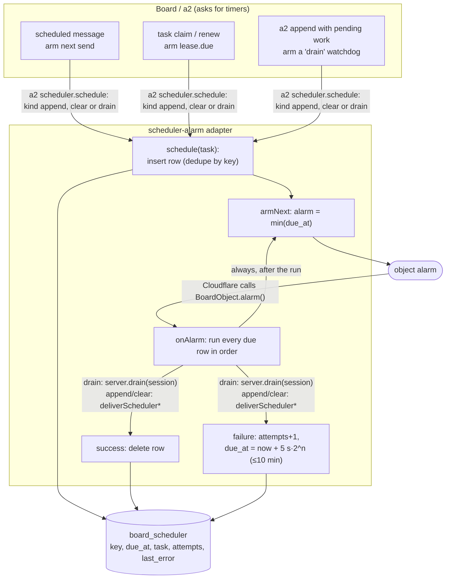

# 4. Timers and the scheduler alarm

Board needs things to happen later: send a scheduled message, expire a task claim, re-run a
background job. Board hands every such job to a **scheduler**. Ours stores each job as a SQLite
row and keeps one Durable Object **alarm** (a wake-up time Cloudflare stores with the object)
set to the earliest one.

## Who asks for a timer

All of Board's timers go through a2's `scheduler.schedule(task)`. A task is one of three kinds:

- **append**: "add these events to that session at time T". Made by `session.schedule`
  (`node_modules/@vercel/board/dist/local-RoMUU6QX.mjs:2442-2477`).
- **clear**: "clear that session at time T" (`node_modules/@vercel/board/dist/local-RoMUU6QX.mjs:2479-2509`).
- **drain**: "run that session's consumers at time T". a2 asks for one as a watchdog after an
  append that leaves work pending (`node_modules/@vercel/board/dist/local-RoMUU6QX.mjs:2068-2069`,
  `node_modules/@vercel/board/dist/local-RoMUU6QX.mjs:1951-1963`) and to re-run work that failed
  (see [retries](06-retries.md)).

Board uses `append` timers for:

- **Scheduled messages**: each send arms a `schedule.due` event
  (`node_modules/@vercel/board/dist/local-RoMUU6QX.mjs:7152-7163`); a send more than 5 days out
  is armed in hops of at most 5 days (`node_modules/@vercel/board/dist/local-RoMUU6QX.mjs:6983`,
  `node_modules/@vercel/board/dist/local-RoMUU6QX.mjs:7153`).
- **Task leases**: each claim and renew arms a `lease.due` event
  (`node_modules/@vercel/board/dist/local-RoMUU6QX.mjs:7582-7596`) — see [task leases](05-task-leases.md).

Board gives the scheduler every a2 server it runs (messages, inbox, schedules, registry, tasks,
watchers) so a due job can find the right one
(`node_modules/@vercel/board/dist/local-RoMUU6QX.mjs:10427-10440`). Our adapter keeps that list
(`adapters/scheduler-alarm/src/index.ts:86-89`).

## What our adapter does

`adapters/scheduler-alarm/src/index.ts`:

- `schedule` inserts one row and returns only after it is written, so a restart loses nothing
  (`adapters/scheduler-alarm/src/index.ts:79-85`, rationale `adapters/scheduler-alarm/src/index.ts:34-39`). The same job scheduled twice is one row: drains are keyed by
  session and time, appends and clears by their id (`adapters/scheduler-alarm/src/index.ts:25-27`, `adapters/scheduler-alarm/src/index.ts:81`).
- `armNext` sets the alarm to the earliest `due_at`, but never into the past (`adapters/scheduler-alarm/src/index.ts:44-51`).
- The object's `alarm()` calls `onAlarm` (`hosts/cloudflare/src/index.ts:58-61`).
- `onAlarm` runs every row whose time has come, oldest first (`adapters/scheduler-alarm/src/index.ts:62-65`). Each is delivered to
  its a2 server: a drain calls `server.drain(sessionId)`, an append or clear calls Board's own
  delivery functions (`adapters/scheduler-alarm/src/index.ts:53-60`; those are
  `node_modules/@vercel/board/dist/local-RoMUU6QX.mjs:1560-1567` and
  `node_modules/@vercel/board/dist/local-RoMUU6QX.mjs:1575-1581`).
- Success deletes the row (`adapters/scheduler-alarm/src/index.ts:67-68`). Failure keeps it, counts the attempt, records the error and
  pushes `due_at` back 5 s, doubling, capped at 10 minutes; it is never dropped (`adapters/scheduler-alarm/src/index.ts:14-15`, `adapters/scheduler-alarm/src/index.ts:69-73`).
- After the run it always sets the next alarm, and it never throws, because Cloudflare retries a
  throwing alarm only 6 times (`adapters/scheduler-alarm/src/index.ts:90-98`).

Alarms can fire more than once, so a job may run twice. That is safe: a2's drains, and its
appends and clears keyed by id, can be repeated (`adapters/scheduler-alarm/src/index.ts:36-39`).

## Why not Board's own scheduler

Board's `local()` backend uses `localScheduler()`, which is `setTimeout` in memory
(`node_modules/@vercel/board/dist/local-RoMUU6QX.mjs:10503-10533`). Board says itself that a
restart drops pending timers (`node_modules/@vercel/board/dist/local-RoMUU6QX.mjs:10573-10576`).
A Durable Object is restarted whenever Cloudflare evicts it, so the spike found scheduled
messages and retries dying on eviction (`spike/README.md:54-56`). The alarm adapter replaces it
with the same job shapes (compare `adapters/scheduler-alarm/src/index.ts:53-60` with
`node_modules/@vercel/board/dist/local-RoMUU6QX.mjs:10508-10514`).

## Catch-up on the first request

Besides the alarm, every Board call first starts a catch-up that re-arms every pending
scheduled message (`node_modules/@vercel/board/dist/local-RoMUU6QX.mjs:10463-10466`,
`node_modules/@vercel/board/dist/local-RoMUU6QX.mjs:7317-7341`). Re-arming the same send under
the same name adds nothing (`node_modules/@vercel/board/dist/local-RoMUU6QX.mjs:7147-7151`).
The test "a scheduled post sends after a restart, from the stored alarm" checks the two paths
together (`test/scheduler-alarm.test.ts:32-54`).
