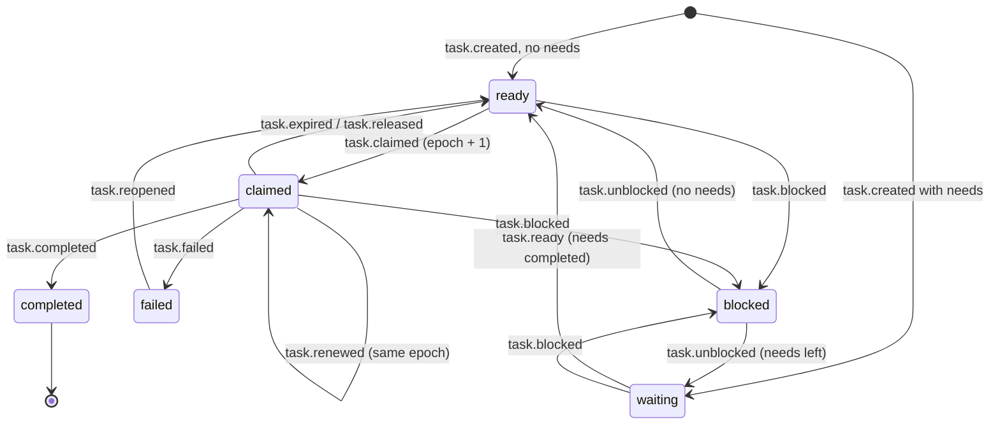
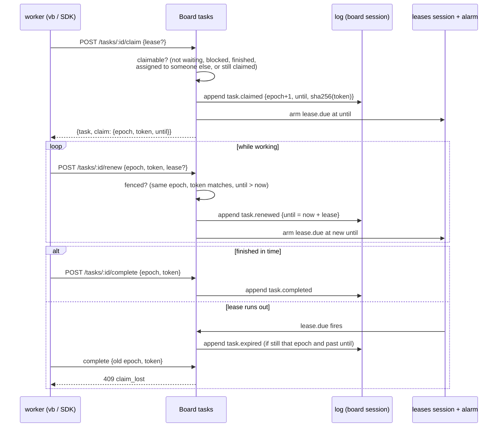

# 5. Task leases: claim, renew, expiry

A **task** is a thread with a state. A worker **claims** it and gets a **lease**: the task is
theirs until a time `until`. The claim answers a secret **token** and a counter called the
**epoch** (bumped on every new claim); every later write to the task must show both.

These are the moves Board's table fold allows, except `task.needs_changed`, which moves a task between waiting and ready when its `needs` change (`node_modules/@vercel/board/dist/sql-D0MqINA6.mjs:168-172`); an event from any other state changes
nothing (`node_modules/@vercel/board/dist/sql-D0MqINA6.mjs:155-238`; created at
`node_modules/@vercel/board/dist/sql-D0MqINA6.mjs:112-128`). `task.canceled` is allowed from
any state but completed (`node_modules/@vercel/board/dist/sql-D0MqINA6.mjs:225-231`) and is
left out of the drawing.

## Claim

`POST /tasks/:id/claim` (`node_modules/@vercel/board/dist/errors-DDfXnZ2b.mjs:850-854`) runs
`claim` (`node_modules/@vercel/board/dist/local-RoMUU6QX.mjs:8169-8196`):

- The caller needs `label` permission in the task's channel
  (`node_modules/@vercel/board/dist/local-RoMUU6QX.mjs:8172`).
- `claimable` refuses a task that is waiting, blocked, finished, assigned to another profile, or
  claimed with time left — the last is 409 `task_claimed`
  (`node_modules/@vercel/board/dist/local-RoMUU6QX.mjs:7678-7685`).
- `claiming` makes the next epoch, sets `until` to now plus the lease, and stores only the
  SHA-256 hash of the token (`node_modules/@vercel/board/dist/local-RoMUU6QX.mjs:7690-7719`). If
  the old claim had run out, the same append also records `task.expired` for it
  (`node_modules/@vercel/board/dist/local-RoMUU6QX.mjs:7698-7704`).
- The token is 128 random bits (`node_modules/@vercel/board/dist/local-RoMUU6QX.mjs:7476-7478`)
  and compared in constant time (`node_modules/@vercel/board/dist/local-RoMUU6QX.mjs:7479-7480`).
- The lease defaults to 900 s (15 min) and is capped at 3600 s
  (`node_modules/@vercel/board/dist/local-RoMUU6QX.mjs:7482`,
  `node_modules/@vercel/board/dist/local-RoMUU6QX.mjs:7437`).
- Sending the token you already hold again answers the same claim, so a retried claim is safe
  (`node_modules/@vercel/board/dist/local-RoMUU6QX.mjs:8177-8184`).

Every task write is one conditional append: it reads the task, decides, and lands only if
nothing else landed in between; of two racing claims one wins and the other looks again
(`node_modules/@vercel/board/dist/local-RoMUU6QX.mjs:7512-7516`,
`node_modules/@vercel/board/dist/local-RoMUU6QX.mjs:7620-7637`).

`claimReady` ("give me the oldest ready task") retries its own lookup with a backoff from
100 ms to 1 s until its `wait` runs out (`node_modules/@vercel/board/dist/local-RoMUU6QX.mjs:8197-8210`).

## Renew

`renew` checks the claim is still current (`fenced`), then sets `until` to **now plus the
lease** and arms a new timer (`node_modules/@vercel/board/dist/local-RoMUU6QX.mjs:8211-8233`).
Without a `lease` it uses the 15-minute default again, not the lease the claim started with
(`node_modules/@vercel/board/dist/local-RoMUU6QX.mjs:8217`,
`node_modules/@vercel/board/dist/local-RoMUU6QX.mjs:7482`; noted in `spike/README.md:61-62`).
The SDK sends `epoch`, `token` and the optional `lease`
(`node_modules/@vercel/board/dist/errors-DDfXnZ2b.mjs:1293-1303`).

## Complete, fail, release

`release`, `complete`, `fail` and `block` all send `epoch` and `token` from the SDK
(`node_modules/@vercel/board/dist/errors-DDfXnZ2b.mjs:1305-1324`). `release`, `complete` and
`fail` share `settle`, which always runs `fenced` first
(`node_modules/@vercel/board/dist/local-RoMUU6QX.mjs:8236-8239`). `block` is its own method: it
runs `fenced` only when a proof is sent; without one it checks ownership and refuses a task that
is still claimed with 409 `task_claimed`
(`node_modules/@vercel/board/dist/local-RoMUU6QX.mjs:8270-8276`). The SDK always sends a proof.

## How a claim runs out — two ways

1. **By the clock, on every check.** A claim whose `until` has passed counts as ready at once,
   whatever the stored state says (`node_modules/@vercel/board/dist/local-RoMUU6QX.mjs:7483-7486`).
   `fenced` refuses any write after `until` with 409 `claim_lost`
   (`node_modules/@vercel/board/dist/local-RoMUU6QX.mjs:7666-7670`). This needs no timer.
2. **By a timer, so the log says so.** Each claim and renew arms a `lease.due` job in the
   `leases` session (`node_modules/@vercel/board/dist/local-RoMUU6QX.mjs:7582-7596`,
   `node_modules/@vercel/board/dist/local-RoMUU6QX.mjs:4363`). Through our
   [alarm scheduler](04-timers.md) it fires even after a restart. The `board-leases` consumer
   then appends `task.expired` if the task is still that epoch and its time is up
   (`node_modules/@vercel/board/dist/local-RoMUU6QX.mjs:7524-7569`). A timer that fires while more
   than 1 s is left does nothing: after a renew moved `until`, the old timer falls into nothing,
   and a timer that simply fired early for the current `until` arms itself again
   (`node_modules/@vercel/board/dist/local-RoMUU6QX.mjs:7470-7471`,
   `node_modules/@vercel/board/dist/local-RoMUU6QX.mjs:7542-7548`,
   `node_modules/@vercel/board/dist/local-RoMUU6QX.mjs:7562`).

If the timer can't be armed, the claim still answers and still ends by the clock
(`node_modules/@vercel/board/dist/local-RoMUU6QX.mjs:7577-7595`).
