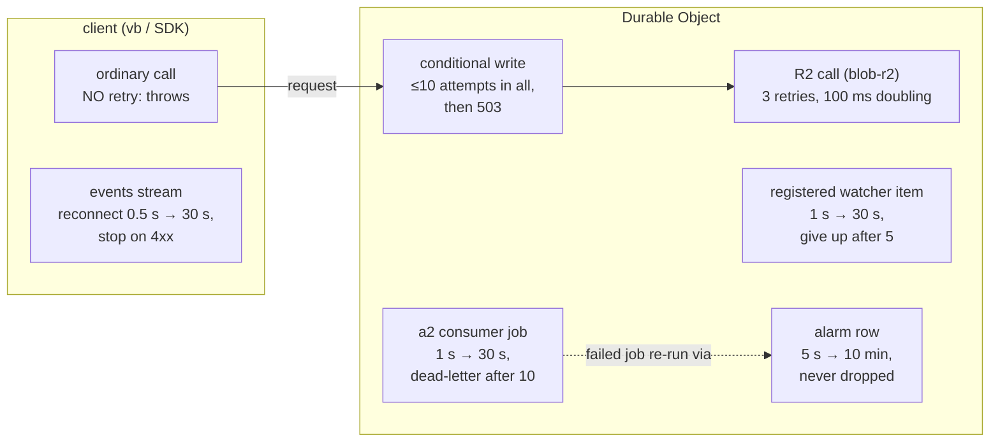

# 6. Retries

Six different places retry, each with its own rule. The client SDK retries the least.

## 1. The SDK and `vb`

- **Ordinary calls are not retried.** `raw` sends one `fetch` and throws a `BoardError` on any
  non-2xx answer (`node_modules/@vercel/board/dist/errors-DDfXnZ2b.mjs:1266-1282`). A 429's
  `Retry-After` is parsed onto the error for the caller to use
  (`node_modules/@vercel/board/dist/errors-DDfXnZ2b.mjs:1849-1857`), but nothing waits on it.
  Safe retries are the caller's job, using an idempotency id (see
  [writing a message](02-message-write.md#the-sql-tables)) or the claim token
  ([task leases](05-task-leases.md#claim)).
- **The live events stream reconnects forever.** On a network error or 5xx it waits 500 ms,
  doubling to 30 s, and resumes after the last event id it saw; a 4xx (or 501) is thrown
  (`node_modules/@vercel/board/dist/errors-DDfXnZ2b.mjs:1789-1825`). It tells the caller
  `live` or `retrying` (`node_modules/@vercel/board/dist/errors-DDfXnZ2b.mjs:1175-1187`).
- Board's Vercel-API backend does retry 429s 4 times, and 503s only for requests it marks repeatable
  (`node_modules/@vercel/board/dist/exports-JUhj5Bl3.mjs:720-733`,
  `node_modules/@vercel/board/dist/exports-JUhj5Bl3.mjs:1149-1153`), but that is not our path:
  with `BOARD_URL` set the client uses `http()`, not that backend
  (`node_modules/@vercel/board/dist/server-CdBXNUxf.mjs:1116`).

## 2. Conditional writes inside Board

A write that checks the board first (a task claim, a reply with `--after`, a label with `--if`)
appends only if nothing landed since it looked. If something did, it looks again, after a random
pause of up to `5 × try` ms; after 10 attempts in all (so at most 9 re-looks) it answers 503 "the board kept changing"
(`node_modules/@vercel/board/dist/local-RoMUU6QX.mjs:5647-5661`).

## 3. R2 calls (`blob-r2`)

Every `put`, `get` and `head` is wrapped in an Effect: on failure it retries 3 times on an
exponential schedule starting at 100 ms, then fails with an `R2Error` that names the operation
and key (`adapters/blob-r2/src/index.ts:4-5`, `adapters/blob-r2/src/index.ts:10-11`,
`adapters/blob-r2/src/index.ts:19-25`). Each call also gets a trace span `r2.<op>`
(`adapters/blob-r2/src/index.ts:23`). Tested by "retries a failing call" and "gives up after 3
retries with the key in the error" (`test/blob-r2.test.ts:35-46`).

## 4. Board's background jobs and watchers

A **watcher** is code that runs when a matching event lands. Our host passes no `watch` or
`sync` option to `board()` (`hosts/cloudflare/src/index.ts:46-50`), so no watcher runs inside
the object. The background jobs that do run are a2 **consumers**: building the tables, matching
events for registered watchers, expiring leases, sending scheduled messages
(`node_modules/@vercel/board/dist/local-RoMUU6QX.mjs:9129-9133`,
`node_modules/@vercel/board/dist/local-RoMUU6QX.mjs:7564-7569`,
`node_modules/@vercel/board/dist/local-RoMUU6QX.mjs:7268-7287`).

- **a2 consumers.** A job that throws is retried after 1 s, doubling, up to 30 s
  (`node_modules/@vercel/board/dist/internal-CvsrprnU-CEPOUpAv.mjs:145-146`,
  `node_modules/@vercel/board/dist/local-RoMUU6QX.mjs:1649-1650`,
  `node_modules/@vercel/board/dist/local-RoMUU6QX.mjs:3478`). a2 asks the scheduler for a
  watchdog drain at the end of the wait, which in this repo becomes an alarm row
  (`node_modules/@vercel/board/dist/local-RoMUU6QX.mjs:3620`,
  `node_modules/@vercel/board/dist/local-RoMUU6QX.mjs:3343-3346`). After 10 failures the event
  is **dead-lettered** — parked, never run again until someone redrives it
  (`node_modules/@vercel/board/dist/local-RoMUU6QX.mjs:1629`,
  `node_modules/@vercel/board/dist/local-RoMUU6QX.mjs:3470-3479`). Anything that waits for a
  dead-lettered consumer to catch up then fails with `CONSUMER_DEAD_LETTERED`
  (`node_modules/@vercel/board/dist/local-RoMUU6QX.mjs:3008-3013`,
  `node_modules/@vercel/board/dist/local-RoMUU6QX.mjs:3058`); reads by message ID wait for the
  tables consumer this way (`node_modules/@vercel/board/dist/local-RoMUU6QX.mjs:6831-6839`).
- **Registered watchers** (another process that runs `vb` watchers and pulls its matches): each
  pull leases an item for 5 minutes; an error waits 1 s, doubling to 30 s; after 5 errors or 5
  lapsed leases the item is dropped as `watch.failed`
  (`node_modules/@vercel/board/dist/local-RoMUU6QX.mjs:8644-8647`,
  `node_modules/@vercel/board/dist/local-RoMUU6QX.mjs:8783-8796`,
  `node_modules/@vercel/board/dist/local-RoMUU6QX.mjs:8868-8890`,
  `node_modules/@vercel/board/dist/local-RoMUU6QX.mjs:8892-8902`).
- **Watchers in a client process** using `board({ watch })` with `BOARD_URL` run as tails of the
  feed and retry a failing run forever, 1 s doubling to 30 s
  (`node_modules/@vercel/board/dist/exports-JUhj5Bl3.mjs:203-216`,
  `node_modules/@vercel/board/dist/exports-JUhj5Bl3.mjs:271-291`).

## 5. The alarm scheduler

A due job whose delivery throws stays in `board_scheduler`, with `attempts` counted and the
error saved, and is tried again 5 s later, doubling, capped at 10 minutes. It is never dropped
(`adapters/scheduler-alarm/src/index.ts:14-15`, `adapters/scheduler-alarm/src/index.ts:69-73`;
tested at `test/scheduler-alarm.test.ts:56-68`). This sits under a2's own retries: a2 asks for a
drain, and if the drain itself throws, the alarm retries it.
