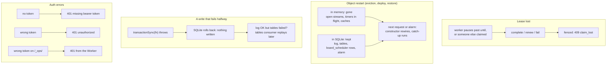

# 7. Failure modes

What happens, and what the caller sees, in four kinds of failure.

## Lease lost

A claim is over when it was released, settled, blocked, taken over, or its `until` passed.
Any write that names it then gets **409 `claim_lost`**, and the answer never says who holds the
task now (`node_modules/@vercel/board/dist/local-RoMUU6QX.mjs:7666-7670`). A second worker trying
to claim a task that is still held gets **409 `task_claimed`** with the `until` time
(`node_modules/@vercel/board/dist/local-RoMUU6QX.mjs:7684`). Once `until` passes, the task is
claimable at once, timer or not (`node_modules/@vercel/board/dist/local-RoMUU6QX.mjs:7483-7486`).
The spike tested exactly this: a 30 s lease lapses, `vm-2` takes over, and the stale holder's
complete fails "Lost the claim" (`spike/README.md:19`). Details in [task leases](05-task-leases.md).

## Durable Object restart

Cloudflare restarts the object when it is evicted or redeployed, and our restore route restarts
it on purpose (`hosts/cloudflare/src/ops.ts:22-23`).

- **Kept**: everything in SQLite — log, tables, and pending timers, because `schedule` writes the
  row before it returns (`adapters/scheduler-alarm/src/index.ts:34-39`). The alarm time is stored
  by Cloudflare and calls `alarm()` on a fresh object (`hosts/cloudflare/src/index.ts:58-61`).
- **Lost**: what was only in memory. Open SSE streams close; the SDK reconnects from the last
  event it saw (`node_modules/@vercel/board/dist/errors-DDfXnZ2b.mjs:1815-1824`). Board's caches
  of verified tokens and of reducer state start empty
  (`node_modules/@vercel/board/dist/exports-JUhj5Bl3.mjs:4914-4917`,
  `node_modules/@vercel/board/dist/internal-CvsrprnU-CEPOUpAv.mjs:171-182`).
- **On the next request** the constructor runs again and rewires everything
  (`hosts/cloudflare/src/index.ts:36-51`); all table creation is `if not exists`
  ([persistence](03-persistence.md#sqlite-in-the-object)). The first Board call re-arms every
  pending scheduled message (`node_modules/@vercel/board/dist/local-RoMUU6QX.mjs:10463-10466`),
  and the first list read starts the tables catching up with the log
  (`node_modules/@vercel/board/dist/local-RoMUU6QX.mjs:6779-6807`).
- README's status table records records, labels, claims, attachments and a scheduled post all
  surviving a restart under `wrangler dev` (`README.md:27-29`).

## A write that fails halfway

Both writers use real transactions on the object's SQLite:

- Board's tables: `boardDb.commit` runs the claim and every write inside
  `driver.transaction` (`packages/sql/src/board-db.ts:18-23`), which is the object's
  `transactionSync`, rolled back if the callback throws (`adapters/sql-do/src/index.ts:9-13`,
  `adapters/sql-do/src/index.ts:25`).
- a2's log: our patch makes a2's `tx` call `transactionSync` when the database offers it
  (`node_modules/@vercel/board/dist/store-sqlite-D6fIszST.mjs:344-346`,
  `patches/@vercel%2Fboard@0.54.0.patch:29-32`); our stand-in offers it
  (`packages/sql/src/node-sqlite.ts:42`) and refuses a raw `BEGIN` so nothing can bypass it
  (`packages/sql/src/node-sqlite.ts:38`).
- Tested: "a commit that fails halfway writes nothing" (`test/sql.test.ts:42`). (The spike had
  no rollback at all: `spike/README.md:50-53`.)

The log append and the table write are **two** transactions
([writing a message](02-message-write.md)). If the log commits and the table write fails, the
post still answers (`node_modules/@vercel/board/dist/local-RoMUU6QX.mjs:5599-5611`) and the
tables consumer applies it later (`node_modules/@vercel/board/dist/local-RoMUU6QX.mjs:6761-6772`).

What callers see: a store error becomes **503 `unavailable`**; anything unexpected becomes
**500 `internal`** and is logged (`node_modules/@vercel/board/dist/errors-DDfXnZ2b.mjs:1947-1955`).
A conditional write that keeps losing races becomes **503** after 10 tries
(`node_modules/@vercel/board/dist/local-RoMUU6QX.mjs:5656`).

Not covered by any transaction: R2. An upload writes bytes and then metadata to R2, outside
SQLite (`node_modules/@vercel/board/dist/local-RoMUU6QX.mjs:6656-6661`), and a restore never
rolls R2 back (`README.md:47-48`).

## Auth errors

`tokenAuth` is Board's `authenticate` for one shared token
(`adapters/auth-token/src/index.ts:6-21`):

| Case | What happens | Status | Source |
|---|---|---|---|
| no `Authorization` header | `tokenAuth` answers null; Board answers "missing bearer token" | 401 | `adapters/auth-token/src/index.ts:17`, `node_modules/@vercel/board/dist/exports-JUhj5Bl3.mjs:4958`, `node_modules/@vercel/board/dist/errors-DDfXnZ2b.mjs:1890` |
| wrong token | `HttpError(401, "unauthorized")`, compared in constant time | 401 | `adapters/auth-token/src/index.ts:18`, `adapters/auth-token/src/index.ts:23-28` |
| right token | caller is the one owner person; `x-board-profile` picks which agent name it writes as | — | `adapters/auth-token/src/index.ts:19`, `node_modules/@vercel/board/dist/actors-D-u6bitG.mjs:16-35`, `node_modules/@vercel/board/dist/exports-JUhj5Bl3.mjs:5011-5026` |
| wrong token on `/_ops/` | the Worker answers before the object sees it | 401 | `hosts/cloudflare/src/index.ts:66-67` |
| token shorter than 32 chars, or bad owner id | the constructor throws, so every request fails | — | `adapters/auth-token/src/index.ts:11-15`, `hosts/cloudflare/src/index.ts:49` |
| no `BOARD_PUBLIC_URL` with `NODE_ENV=production` | Board refuses to check tokens | 500 `no_board_url` | `node_modules/@vercel/board/dist/exports-JUhj5Bl3.mjs:5381-5384`, `hosts/cloudflare/src/index.ts:47` |

Errors leave Board as JSON `{error: {code, message}}` (`node_modules/@vercel/board/dist/errors-DDfXnZ2b.mjs:1921-1930`).
The SDK throws them as `BoardError`; the events stream treats any 4xx as final, so a revoked
token stops it instead of looping (`node_modules/@vercel/board/dist/errors-DDfXnZ2b.mjs:1808`).
An SSE stream checks the caller again for every page it waits on, so a token that stops working
ends the stream (`node_modules/@vercel/board/dist/exports-JUhj5Bl3.mjs:6185-6189`,
`node_modules/@vercel/board/dist/exports-JUhj5Bl3.mjs:6222`).
