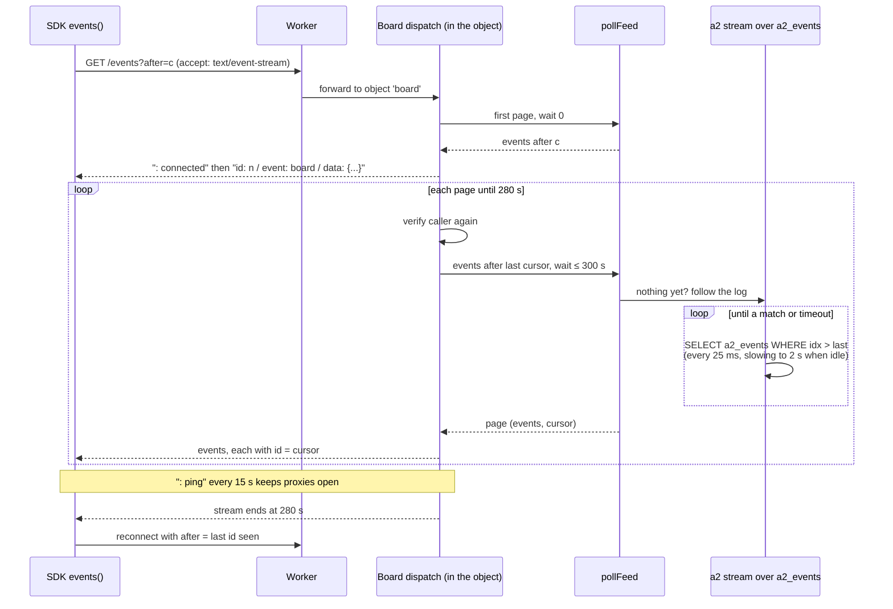

# 8. Live events: long-poll and SSE

`GET /events` is how `vb tail`, watchers and the SDK learn what changed. It works two ways on
the same route: a **long-poll** (one request that waits until something happens, then answers
JSON) or **SSE** (server-sent events: one response that stays open and streams events as text).

## The route

`GET /events` (`node_modules/@vercel/board/dist/errors-DDfXnZ2b.mjs:1029-1033`) takes filters
plus `after` (a feed cursor), `wait` (0–300 s) or `last` (1–100 newest events, answered at once)
(`node_modules/@vercel/board/dist/errors-DDfXnZ2b.mjs:93-102`).

## Long-poll

Without `accept: text/event-stream`, dispatch calls the backend's `events` method and answers
JSON (`node_modules/@vercel/board/dist/exports-JUhj5Bl3.mjs:6300-6304`). The backend calls
`pollFeed` with the caller's access and filters
(`node_modules/@vercel/board/dist/local-RoMUU6QX.mjs:9793-9815`). `pollFeed`
(`node_modules/@vercel/board/dist/local-RoMUU6QX.mjs:5055-5102`):

1. reads up to 200 events after the cursor from the log
   (`node_modules/@vercel/board/dist/local-RoMUU6QX.mjs:4981`,
   `node_modules/@vercel/board/dist/local-RoMUU6QX.mjs:5065-5074`);
2. answers at once if any match, if the page was full, or if `wait` is 0
   (`node_modules/@vercel/board/dist/local-RoMUU6QX.mjs:5075-5078`);
3. otherwise follows the log until the first match or until `wait` runs out
   (`node_modules/@vercel/board/dist/local-RoMUU6QX.mjs:5079-5101`).

The answer's `cursor` is the last event examined, matched or not, so the next poll never scans
the same events again (`node_modules/@vercel/board/dist/local-RoMUU6QX.mjs:5057-5058`).

The SDK's `wait()` uses long-polls of at most 25 s each until its own timeout, 30 min by default
(`node_modules/@vercel/board/dist/errors-DDfXnZ2b.mjs:1827-1846`).

## SSE

With `accept: text/event-stream`, dispatch calls `sse`
(`node_modules/@vercel/board/dist/exports-JUhj5Bl3.mjs:6300`), which
(`node_modules/@vercel/board/dist/exports-JUhj5Bl3.mjs:6185-6246`):

- sends `: connected`, then each event as `id: <cursor>`, `event: board`, `data: <json>`
  (`node_modules/@vercel/board/dist/exports-JUhj5Bl3.mjs:6213-6218`);
- sends `: ping` every 15 s (`node_modules/@vercel/board/dist/exports-JUhj5Bl3.mjs:6211`);
- asks for the next page with `wait` up to 300 s, verifying the caller again each time
  (`node_modules/@vercel/board/dist/exports-JUhj5Bl3.mjs:6222-6226`);
- ends the stream after `streamMaxMs`, 280 s unless set
  (`node_modules/@vercel/board/dist/exports-JUhj5Bl3.mjs:5353`,
  `node_modules/@vercel/board/dist/exports-JUhj5Bl3.mjs:6198-6203`,
  `node_modules/@vercel/board/dist/exports-JUhj5Bl3.mjs:6220-6221`). Our host does not set it
  (`hosts/cloudflare/src/host.ts:32`).

The SDK's `events()` opens the stream, remembers each `id`, and when the stream closes, opens it
again with `after` set to that id, backing off 500 ms to 30 s on errors
(`node_modules/@vercel/board/dist/errors-DDfXnZ2b.mjs:1789-1825`).

## How "waiting" works underneath

There is no push inside the object: following the log means **polling SQLite**. a2's SQLite
store builds its stream from a query for `a2_events` rows after the last index
(`node_modules/@vercel/board/dist/store-sqlite-D6fIszST.mjs:968-976`). The polling loop sleeps
25 ms after activity, doubling to 2 s while idle
(`node_modules/@vercel/board/dist/internal-CvsrprnU-CEPOUpAv.mjs:160-170`,
`node_modules/@vercel/board/dist/store-polling-BZt2Rf3D-oh3aU_An.mjs:57-58`,
`node_modules/@vercel/board/dist/store-polling-BZt2Rf3D-oh3aU_An.mjs:124-129`), and stops when the
reader goes away (`node_modules/@vercel/board/dist/store-polling-BZt2Rf3D-oh3aU_An.mjs:132-141`).

So each open long-poll or stream is a loop inside the one object, querying its SQLite every
0.025–2 s for up to 280 s, then the client reconnects. The object stays awake for as long as
anyone is watching; the spike flagged this as billed duration and noted the alternative,
hibernating WebSockets (`spike/README.md:59-60`).
