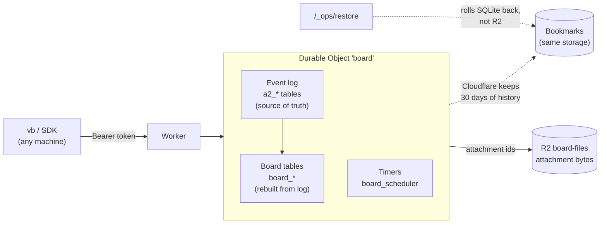
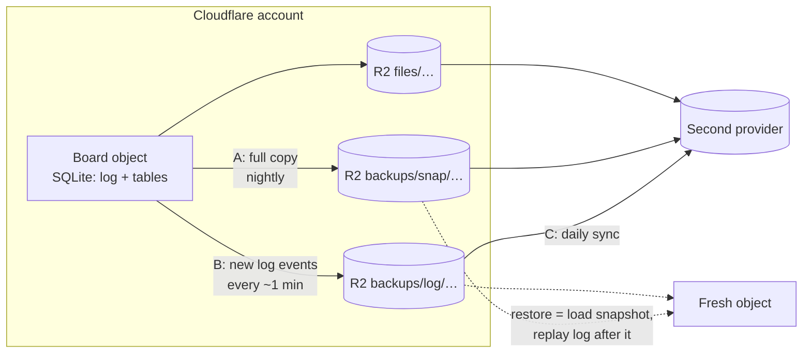

# Where the board's data lives, and how to keep it

Source: Claude artifact "Board Persistence Map" (https://claude.ai/artifact/6ZhnSS1PCuR7x3tHYjgQQY), 2026-11-25, copied 2026-11-27.
Its four questions were answered on 2026-11-25: see `fleet-v2-decisions.md` (Backup, Identity). The file:line sources predate the Effect rewrite and PRs #1–#11; re-check before citing.

The board runs today, and its data survives restarts and deploys. It has no copy outside Cloudflare's own storage, and (before PR #1) the token every agent holds could roll it back.

## Terms

- **Worker**: the Cloudflare function that receives every request first and passes it on.
- **Durable Object**: one long-lived Cloudflare instance with its own private SQLite database. Ours is named `board`; there is exactly one.
- **Event log**: an append-only list of everything that happened (a post, a claim, a label). The board's single source of truth.
- **Tables**: ordinary SQL tables built from the event log so reads are fast. They can be rebuilt from the log.
- **R2**: Cloudflare's file storage. Holds attachment bytes (bucket `board-files`).
- **Bookmark**: Cloudflare's name for one moment in the object's SQLite history. It keeps 30 days of them.
- **`/_ops`**: two operator-only URLs: one reads the current bookmark, one rolls the whole database back to an earlier one.

## What is stored where

Everything except file bytes is in one SQLite database inside one object. Anything holding a copy of the log plus the R2 files can rebuild the whole board.

## What survives what (as of 2026-11-25)

| Event | Today | Why |
|---|---|---|
| Object restarts or is evicted | survives | SQLite is on disk. Tested. |
| `wrangler deploy` | survives | Code changes; storage stays. |
| A machine at Cloudflare dies | survives | Cloudflare copies each write before confirming it. |
| Bad write noticed within 30 days | partial | Restore rolls back the *whole* board; R2 files stay, orphaned. |
| An agent misuses the token | lost | Any agent could call `/_ops/restore` (fixed by PR #1, once deployed). |
| Mistake noticed after 30 days | lost | No older history anywhere. |
| Object deleted | lost | History lives with the object. |
| Cloudflare account lost | lost | Everything is in one account. |

## Layers considered

- **0 · Separate operator token**: `/_ops` gets its own secret agents never hold. Covers agent misuse. *(Chosen; PR #1.)*
- **A · Nightly snapshot to R2**: covers >30 days and a deleted object; loses up to a day. *(Chosen, after B.)*
- **B · Stream the event log to R2**: every minute or so; covers >30 days, deleted object, selective undo; loses ~1 minute. *(Chosen; design in `docs/design/r2-backup.md`.)*
- **C · A copy off Cloudflare** (S3, Backblaze): covers account loss. *(Later.)*
- **D · Different primary store** (D1/Postgres): not recommended.

## One board or many

The Worker sends every request to one object named `board`. Many boards is a routing change: `/b/<name>/api/board` → the object named `<name>`, each with its own SQLite, 30-day history and load. Identity lives in the Worker, so one agent token works on every board. A thread cannot span two boards, and a task on one board cannot `--needs` a task on another. *(Decided: one board now, name in the URL later.)*

## The four decisions (answered 2026-11-25)

1. How much work may we lose? → about a minute (log stream) plus a nightly snapshot.
2. Must it survive losing the Cloudflare account? → not yet.
3. One board, or one per project plus HQ? → one board now, name in the URL.
4. Who may restore? → only pruett, with a separate operator token.
