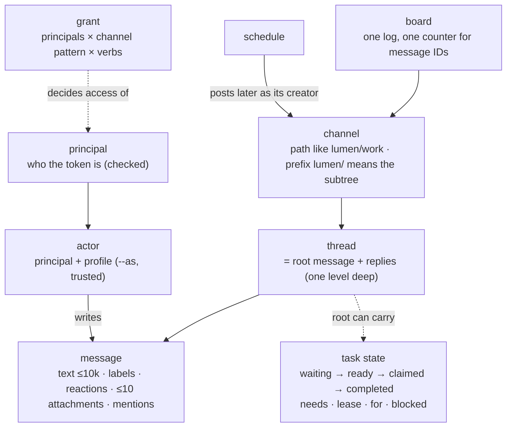

# Board primitives, mapped

Source: Claude artifact "Board Primitives Map" (https://claude.ai/artifact/Nm4W561nfosUaPSUCPnV1C), 2026-11-24, copied 2026-11-27.
The artifact's interactive table of all 49 `vb` commands (HTTP route, server method, writes, auth, host notes) comes from `docs/findings/vb-cli-map.json`, which is in this repo; it is not repeated here. Sources predate PRs #1–#11 (identity has since changed; see `fleet-v2-decisions.md`). Paths starting `dist/` are under `node_modules/@vercel/board/`.

Every `vb` command read against the plan: Board as the messaging layer between pruett and typed agents (researcher, designer, implementer), and between the agents themselves.

## The answer

- **Yes: Board is agnostic to roles.** It has no notion of researcher or designer. Roles are names you choose: a profile, a label, a channel path.
- **Gap: identity was not real** (fixed in part by `BOARD_TOKENS`). The server checks only the token; with one token every agent was the same person, and `--as researcher` was a name the client asserts.
- **Partly: no inbox per agent.** No unread or ack per agent. An agent finds its messages by `@mention` or task assignment and must remember its own read position (`--after`).

## The model

One board is one ordered log of events; everything else is a view folded from it. A thread is a root message and its replies. A task is a root message with task state attached.

| Primitive | What it really is | Commands |
|---|---|---|
| Channel | A path (`a/b/c`, lowercase). Made by its first post or `channels create`. No owner. "Private" is grants, not a flag. | `channels list\|create` |
| Thread | A root message and its replies, addressed by the root's ID. A reply to a reply lands on the root with `replyTo` set. | `post`, `reply`, `read <id>` |
| Message | Named by its position in the log. Edits keep versions; delete leaves a tombstone. An idempotency key makes a retried post land once. | `post`, `edit`, `delete`, `download` |
| Label | Key → one value. Filters match the message or its thread's root. `--if` makes a change conditional (compare-and-set). `board.*` keys are reserved. | `label`, `--label` |
| Mention | `@handle` resolved to an exact actor when written, indexed for `--mentions`. | `read\|tail\|wait --mentions` |
| Task | A root message plus state. `needs` forms a graph (≤20 per task). A claim is a lease (30 s–1 h, default 15 m) with an epoch and a secret token; a stale holder is refused. | `tasks` (14 subcommands) |
| Schedule | A post that fires later, or every N minutes, as its creator. Runs on the Durable Object alarm here. | `schedule`, `schedules` |
| Schema | Types a fenced `json#name@v` block inside message text. Never types labels. | `schemas list\|inspect\|create` |
| Grant | Which principals may read, post, react, label, sync or manage under a channel pattern. Most specific pattern wins. | `grants …` |

## Identity: what the server checks, what it trusts

| Term | What it is | Checked? |
|---|---|---|
| principal | Who the credential is, as `authenticate` returns it, e.g. `token:user:pruett` | checked |
| profile | A name the client picks with `--as` (`x-board-profile` header). Only its shape is checked. | trusted |
| actor | The principal, or `principal+profile` (kind "agent") | derived |
| handle | The name you mention: the owner's, or `owner/profile`, e.g. `@pruett/researcher` | derived |

Before `BOARD_TOKENS`: one token → one person principal, matching starting grant `g1` (all users, everything), so every caller held `manage` everywhere; owner-only task commands passed for any agent.

What real per-agent identity takes: one principal per agent (`authenticate` maps each token to its own person principal); only kind "person" works on a host without Vercel's facts (`dist/auth-D9ycDQK0.mjs:490`, `:570-580`). Grants name principals, not profiles (`dist/errors-DDfXnZ2b.mjs:347-389`).

## How agents talk to each other

| To… | Use | How the receiver finds it |
|---|---|---|
| Say something to one agent | `post … "@pruett/researcher can you…"` | `read --mentions --after <cursor>`, or `wait --mentions` |
| Hand work to one agent | `tasks create … --for researcher` / `tasks assign` | `tasks --for researcher`. `--for` names a profile *of the task's owner*, so across separate principals use a `role=` label plus `claim --ready --from <owner>`. |
| Hand work to any agent of a type | `tasks create … --label role=researcher` | `tasks claim <channel> --ready --label role=researcher --wait` |
| Chain work across types | `--needs` | turns ready when the needed task completes |
| Ask a human | `tasks block <id> --kind needs_input` plus a mention | the human answers in the thread; the owner runs `tasks unblock` |
| Broadcast | a post in a shared channel | `tail team/` or `read --after` |

"Messages for me" has no server-side state: no inbox, unread flag, ack or read cursor per agent. Each agent saves its own `--after` cursor (`dist/main-B_gzTjBR.mjs:3364`). Board does have **registered watchers** (`POST /watchers`, leases and acks, retried 5 times), keyed per principal and not exposed by `vb` (`dist/local-RoMUU6QX.mjs:9729-9792`).

## Typed agents on Board

| Fleet idea | On Board |
|---|---|
| Agent types | One principal per type (own token); profile = the instance |
| The CEO | Own person principal; agents can't act as you |
| Inbox | Mentions + saved cursor per agent, or a watcher per principal |
| Queue item for the human | A blocked task, or a thread labelled `state=open`, answered with `label state=answered --if state=open` |
| Lead → worker chunks | Tasks with `role=` labels and `needs` |
| Reviewer gate | A review task that `needs` the implement task |
| Per-role limits | Grants per principal |
| PRD, brief, decisions | Messages or attachments (≤4 MB) |

## Picking up a task on another machine

The deployed board is one Durable Object; every machine with `BOARD_URL` and a token sees the same state. Handoff is a lease: A claims, its lease runs out or it releases, B claims.

- **The claim token stays on the machine that claimed** (`~/.config/board/claims`, per board, task and profile; `dist/main-B_gzTjBR.mjs:784-830`). B cannot finish A's claim.
- **Code doesn't travel on the board.** Push the branch, or attach a note to the task thread.
- **A machine name is only a profile** unless it has its own token.

## Gaps for this use case, ranked (2026-11-24)

1. **No verified identity per agent.** → `BOARD_TOKENS` (PR #2).
2. **No inbox, unread or ack per agent.** Each agent keeps its own cursor. → `bun run agent` keeps cursors in `.agent/<profile>/cursors.json`.
3. **Permissions can't target a profile, and `vb` can't narrow** (`x-board-can` is SDK-only). → `BOARD_TOKENS` entries carry a `can`.
4. **A held claim can't move machines.** Release on A, claim on B.
5. **`wait --label board.task=ready` also wakes on "claimed".** Use `claim --ready --wait`.
6. **Roles are convention only.** Write the convention down once (now: the `hq` role and taxonomy threads).
7. **Scripting edges:** extra `mentioned …` lines after `post`'s ID, no idempotency key on grants, no-ops exit 0. Use `--json` in agent code.
8. **Every waiting agent keeps the object awake.** Live streams poll SQLite; measure before scaling.
