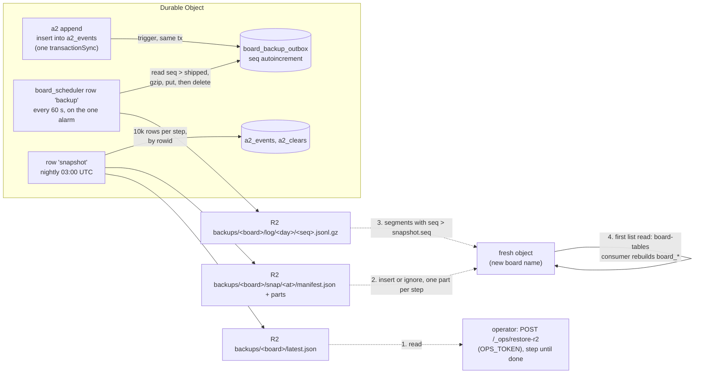

# A copy of the board outside its Durable Object

Design, 2026-11-25. Decided inputs: lose at most about 1 minute; Cloudflare only for now; one
board now, board name in the URL later; only the owner restores, with a separate operator token.
`dist/…` means `node_modules/@vercel/board/dist/…` (Board 0.54.0 with our patch).

## Recommendation

Capture every event with a SQLite **trigger** into an outbox table in the same transaction as
a2's append; a **60 s job in our scheduler-alarm adapter** ships the outbox to R2 as gzipped
JSONL segments; a **nightly job** exports all of `a2_events` in 10k-row parts; **restore**
loads the newest snapshot into a fresh object, replays the segments after it, and lets Board's
own tables consumer rebuild the tables. Nothing in Board or a2 is patched further.



## Where the stream hooks in, and why

**The hook is a trigger on `a2_events`**, created by the host next to `board_scheduler`'s table
(the same place we already own, `adapters/scheduler-alarm/src/index.ts:84`):

```sql
create table if not exists board_backup_outbox (
  seq integer primary key autoincrement,
  session_id text not null, idx integer not null, event_type text not null,
  payload text not null, event_id text not null, created_at integer not null, cause text);
create trigger if not exists board_backup_capture after insert on a2_events begin
  insert into board_backup_outbox (session_id, idx, event_type, payload, event_id, created_at, cause)
  values (new.session_id, new.idx, new.event_type, new.payload, new.event_id, new.created_at, new.cause);
end;
```

- a2 inserts each event with one statement inside one transaction
  (`dist/store-sqlite-D6fIszST.mjs:241-243`, `:437-452`, `:464-507`), and that transaction is the
  object's `transactionSync` (`dist/store-sqlite-D6fIszST.mjs:344-346`,
  `adapters/sql-do/src/index.ts:31`). A trigger fires inside it, so a rolled-back append leaves
  no outbox row and a committed one always leaves exactly one. Clear markers are inserted the
  same way (`dist/store-sqlite-D6fIszST.mjs:1001-1003`), so clears are captured too.
- The log is not one session. Board keeps seven: `board`, `inboxes`, `registry`, `schedules`
  (plus `schedules:<deployment>`), `leases`, `access`, `schemas`
  (`dist/local-RoMUU6QX.mjs:4096-4471`, `:7146`). Tasks and claims live in `leases`, scheduled
  posts in `schedules`. A table-level trigger sees all of them.
- `seq` is a global order across sessions, so a segment is a contiguous seq range and a gap in
  the chain is detectable by arithmetic.

**Shipping runs on the object's one alarm.** Cloudflare gives each object a single alarm
(https://developers.cloudflare.com/durable-objects/api/alarms/) and `scheduler-alarm` already
owns it and runs every due row in order (`adapters/scheduler-alarm/src/index.ts:129-157`). The
adapter gains two host-level task kinds beside a2's `append | clear | drain`
(`adapters/scheduler-alarm/src/index.ts:59-60`, `:112-126`): `backup` and `snapshot`. Each is a
`board_scheduler` row that re-inserts itself with the next `due_at` when it finishes, so it
survives eviction like every other timer (`docs/architecture/04-timers.md:64-66`) and never
races the alarm (`armNext`, `adapters/scheduler-alarm/src/index.ts:104-110`).

The `backup` job, every 60 s:

1. `select * from board_backup_outbox where seq > ? order by seq limit 5000`, with `?` =
   `board_backup.shipped_seq`. Empty: re-arm at +60 s, done (about 5 ms, no R2 call).
2. Encode as JSONL, gzip with `CompressionStream`, `put` one segment. If a burst exceeds 5000
   rows or 4 MB raw, loop: one segment per 5000.
3. Only after the put resolves, `update board_backup set shipped_seq = ?` and
   `delete from board_backup_outbox where seq <= ?`. A crash between 2 and 3 ships the same rows
   again under a new key; restore dedups on `(session_id, idx)`.

**Batch size and cadence.** 60 s is the loss window the owner chose. Alarms "can be delayed by
up to a minute" (https://developers.cloudflare.com/durable-objects/api/sqlite-storage-api/), so
the worst case is about 2 minutes; set the cadence to 30 s if that matters. At 10k events/day
a segment averages 7 events, about 7 KB raw, and R2 allows 1 write per second per key, which a
unique key per segment never approaches
(https://developers.cloudflare.com/r2/platform/limits/).

**The `snapshot` job**, nightly at 03:00 UTC, in steps so no step exceeds the 30 s CPU limit
per alarm (https://developers.cloudflare.com/durable-objects/platform/limits/):

1. First step records `seq = max(outbox.seq)` and `rowid_through = max(a2_events.rowid)` in
   `board_backup`. Events written later have a larger rowid and a larger seq, so "all rows with
   rowid ≤ rowid_through" and "all outbox rows with seq > seq" partition the log exactly.
2. Each step exports the next 10,000 rows by rowid as `events-NNNNN.jsonl.gz`, re-arms itself
   at +1 s, and stops when past `rowid_through`. Events are immutable, so parts taken minutes
   apart are consistent. a2 deletes rows only below a session's clear marker
   (`dist/store-sqlite-D6fIszST.mjs:1030-1033`, `:330-337`), never the newest, so rowid never
   reuses a value.
3. Last step writes `clears.json` (all of `a2_clears`), `manifest.json`, then `latest.json`.
   A manifest without `latest.json` pointing at it is incomplete and is ignored by restore.

## R2 key layout

One bucket, `board-files` (`hosts/cloudflare/wrangler.jsonc:10`); `files/` was reserved for
exactly this (`adapters/blob-r2/src/index.ts:21-22`). `<board>` is the object's name,
`board` today (`hosts/cloudflare/src/index.ts:26`), the URL segment later.

| Key | Holds |
|---|---|
| `backups/<board>/log/<YYYY-MM-DD>/<seq first, 12 digits>.jsonl.gz` | one segment; customMetadata `first`, `last`, `count`, `at` |
| `backups/<board>/snap/<YYYY-MM-DDThh-mm>/manifest.json` | `{board, at, seq, rowidThrough, parts[], rows, layout: "cursors-1", board: "0.54.0"}` |
| `backups/<board>/snap/<…>/events-NNNNN.jsonl.gz`, `clears.json` | 10k `a2_events` rows per part; all of `a2_clears` |
| `backups/<board>/latest.json` | `{snapshot: "<…>", seq, at}`; written last, read first |

Segments sit under a day prefix so a restore lists only the days since the snapshot
(`list({prefix, cursor})`, pages of up to 1000,
https://developers.cloudflare.com/r2/api/workers/workers-api-reference/). Lifecycle rules:
expire `backups/*/log/` after 90 days and `backups/*/snap/` after 30 days
(https://developers.cloudflare.com/r2/buckets/object-lifecycles/); the chain a restore needs is
always under 1 day, from the last snapshot.

Attachments move under the board name too: `makeR2Blob({ prefix: "files/<board>/" })`
(`adapters/blob-r2/src/index.ts:36`), giving `files/<board>/board/attachments/<id>`, since the
inner `board/` is Board's own constant (`dist/local-RoMUU6QX.mjs:6626-6629`).

## Restore into a fresh object

Operator only. `/_ops/` reads `OPS_TOKEN` instead of `BOARD_TOKEN`
(`hosts/cloudflare/src/ops.ts:90-93`, `hosts/cloudflare/src/index.ts:87-92`), a second Worker
secret that agents never hold. Restore always targets a **new board name**: the broken object
keeps its 30-day history, and no step is destructive.

1. `GET /_ops/backup?board=<old>` → `latest.json`: snapshot id, `seq`, age.
2. `POST /_ops/restore-r2 {"from": "<old>", "snapshot": "<id>", "through": <seq | ISO time>}`
   on `/b/<new>/`: creates `board_restore` (progress) in the new object and **does not create
   the trigger yet**, so restored rows are not re-shipped.
3. `POST /_ops/restore-r2/step` until `{done: true}`; the operator script loops. Each step
   loads one part: `insert or ignore into a2_events …` in one `transactionSync`, then
   `a2_clears` from `clears.json`. Then segments from day `snapshot.at` onward, keeping rows
   with `seq > snapshot.seq` and up to `through`; an `a2.cleared` row also upserts `a2_clears`
   (`dist/store-sqlite-D6fIszST.mjs:1001-1004`).
4. Finish: create the trigger and outbox, write `board_backup.shipped_seq = 0`, take a snapshot
   at once (`POST /_ops/snapshot`) so the new chain starts clean under `backups/<new>/`.
5. Run any list read (`vb read fleet2/work`). The first read starts the tables consumer, which
   has `backfill: true` and so opens at the clear marker and applies every event
   (`dist/local-RoMUU6QX.mjs:6761-6772`, `dist/local-RoMUU6QX.mjs:6779-6807`,
   `dist/store-sqlite-D6fIszST.mjs:399`). Every other consumer opens at the current head, so watchers, leases and sync do
   **not** re-run old events (`dist/store-sqlite-D6fIszST.mjs:399`; only `board-tables` and
   `board-schedules` backfill, `dist/local-RoMUU6QX.mjs:6767`, `:7273`). Scheduled posts are
   re-armed by the first request's catch-up (`docs/architecture/04-timers.md:93-98`).
6. Poll `GET /_ops/backup` until `tables.position == head`; point `BOARD_URL` at the new board.

**How long** (estimates to confirm in the prototype; 1 KB per event assumed):

| Log size | R2 reads | Inserts | Tables rebuild | Total |
|---|---|---|---|---|
| 10k events (one day) | 1 part + ≤1440 segments, 6 in flight: ~10 s | ~1 s | 10k × ~2 ms ≈ 20 s | ~1 min |
| 1M events (100 days) | 100 parts, ~1 s each, 100 steps | in the steps | 1M × ~2 ms ≈ 35 min, only while the object is awake (`docs/findings/arch-gaps.md:69-74`) | ~40 min, keep polling |

The 1M case is bounded by the tables consumer, one transaction per event
(`docs/architecture/02-message-write.md:105-111`), not by R2. Memory stays under the 128 MB
isolate limit because parts are 10k rows and streamed through `DecompressionStream`.

## Attachments after a restore (arch-gaps item 3)

An upload puts bytes then metadata to R2 before the message that names the id is posted
(`dist/local-RoMUU6QX.mjs:6656-6661`), and R2 writes are durable and strongly consistent on
return (https://developers.cloudflare.com/r2/reference/durability/,
https://developers.cloudflare.com/r2/reference/consistency/). So every attachment an event in
the backup names already exists in the bucket, and the restore never touches `files/`: in the
same account, attachments line up with no step at all. The reverse never lines up: uploads whose
post fell in the lost minute, or whose post never happened, stay as orphans. A monthly
`sweep-files` job (list `files/<board>/`, keep ids present in `board_terms`, delete the rest
older than 1 day) closes it; not in this cut. Restoring into another account later means copying
`files/<board>/` as well as `backups/<board>/`.

## Cost per month at 10k events/day

| Line | Amount | Price | Source |
|---|---|---|---|
| R2 Class A (segment puts) | ≤ 43k | free under 1M; else $0.19 | https://developers.cloudflare.com/r2/pricing/ |
| R2 Class A (snapshot parts, 100 days in) | ~3k | free | same |
| R2 storage (90 days of segments + 30 snapshots at day 100) | < 3 GB | free under 10 GB; else $0.05 | same |
| DO rows written (outbox insert + delete, setAlarm) | ~650k | within 50M included | https://developers.cloudflare.com/durable-objects/platform/pricing/ |
| DO alarm invocations | 43k | within 1M included | same |
| DO duration (43k wakes × ~20 ms) | ~110 GB-s | within 400k included | same |

Effectively $0 on top of the Workers Paid plan. The one line that grows is snapshot storage,
linear in log size times 30 days of retention; lower `snap/` retention to 7 days when it matters.

## What fails and how we notice

`GET /_ops/backup` answers `{outbox, shippedSeq, lastPutAt, lagSeconds, snapshot: {at, seq,
age}, lastError, tables: {position, head}}`. A check from the owner's machine once a day (a
cron, or a Fleet HQ task) fails loudly when `lagSeconds > 600` or snapshot age > 36 h.

| Failure | Effect | Noticed by |
|---|---|---|
| R2 put keeps failing | outbox grows (10 MB/day, far from 10 GB); row retries with backoff, `last_error` kept (`adapters/scheduler-alarm/src/index.ts:40-41`, `:146-153`) | `lagSeconds`, `[board] scheduled backup failed` in Workers Logs |
| Eviction mid-ship | rows deleted only after the put: at-least-once; duplicate segment | none needed; restore dedups |
| A slow drain ahead in the serial alarm loop (`docs/findings/arch-gaps.md:60-64`) | backup late | `lagSeconds` |
| Board upgrade renames `a2_events` or changes `LAYOUT` (`dist/store-sqlite-D6fIszST.mjs:22`) | trigger stops firing; snapshot layout mismatch | status compares `max(a2_events.rowid)` with the last captured rowid; restore refuses a manifest whose `layout` differs |
| Alarm delayed up to 1 min | loss window ~2 min | accepted, or 30 s cadence |
| Lifecycle expires a needed segment | only if no snapshot succeeded for 90 days | snapshot age in the daily check |
| Agent misuse of the token | cannot restore: `/_ops/` needs `OPS_TOKEN` | — |

## Alternatives, one line each

- **a2 consumer on the `board` session**: sees one of seven sessions and can only be registered
  inside Board's `local()`; rejected.
- **Sniff `insert into a2_events` in the sql-do driver**: couples to a2's SQL text; the trigger
  is in-transaction and text-free.
- **Worker cron every minute calling the object**: same cost, 15-min config propagation, needs
  fan-out per board later; the alarm is already in the object.
- **Put to R2 on every append**: no loss window, but a Class A op and R2 latency on every
  write, and still needs the outbox for crash safety.
- **Nightly snapshot only**: loses a day; the earlier page already rejected it.
- **Export from PITR bookmarks**: Cloudflare offers no export of a bookmark.
- **Replace the primary store (D1, Postgres)**: loses same-place transactions; not recommended.

## What the prototype must prove first

1. **The trigger works in the object's SQLite and captures in-transaction**: a2's store still
   opens after our DDL, an append that throws leaves no outbox row, a committed one leaves
   exactly one per event, and `seq` is contiguous across sessions.
2. **Raw inserts rebuild a fresh board correctly**: after `insert or ignore` of 10k events plus
   `a2_clears`, the first list read makes `board-tables` apply everything, `board-watchers` and
   `board-leases` run nothing old, tasks and claims read back. Measure insert rows/s and tables
   events/s to replace the estimates above.
3. **The jobs share the alarm safely**: the `backup` row runs every 60 s beside due timers, a
   5000-row gzip + put stays well under 30 s CPU, and a forced eviction between put and delete
   yields a duplicate segment, not a gap.
